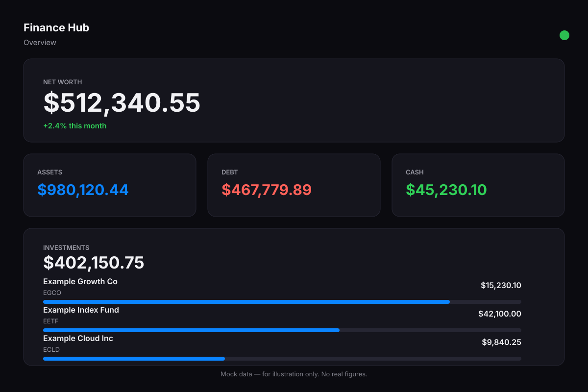
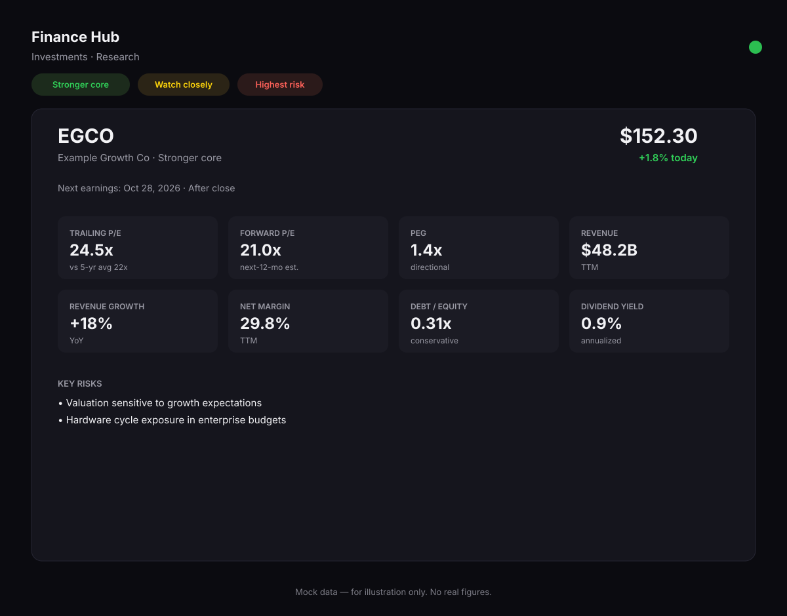
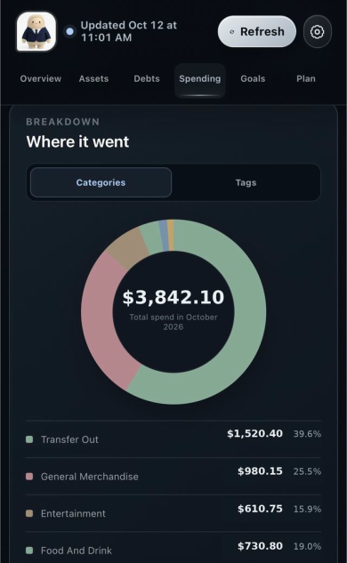

# Finance Hub

A personal finance hub: net worth tracking, investments with per-stock research,
spending analysis, bills, subscriptions, and savings goals — in one clean,
native-app-style dashboard.

> **Note:** This repository is documentation and a reference architecture for the
> project. All figures, account names, and tickers in this repo are **synthetic
> examples** — no real personal financial data is included anywhere.

## What it does

- **Overview** — Net worth, assets vs. debt, cash, and investment totals at a glance.
- **Investments** — Every account and holding, plus a **Research** tab with a
  per-stock card: business summary, 8 key metrics (P/E, PEG, revenue, growth,
  margin, debt/equity, dividend yield), risks, sources, and the next earnings date.
  The research universe follows your actual holdings automatically.
- **Spending** — Transactions synced from your banks, with categories, budgets
  that track progress as transactions arrive, and period totals.
- **Bills** — Actual household bills you pay (utilities, car payments), with due
  dates and autopay status. Kept strictly separate from subscriptions.
- **Subscriptions** — Recurring charges auto-detected from transaction history.
- **Goals** — Savings goals (e.g., an opportunity fund, a rental-property fund)
  with progress computed from live cash balances. No dollar amounts leak into
  titles — percentages and milestones only.

## How it works

- **Snapshot store** — The entire hub state is one versioned JSON snapshot
  (see `docs/DATA_MODEL.md`). Updates go through typed actions; full-snapshot
  writes have replace semantics, targeted actions patch one section.
- **Read-only bank sync** — Accounts, holdings, and transactions sync via Plaid
  (read-only). The app can never move money.
- **Dynamic research** — The stock-research universe is derived from actual
  holdings (individual stocks ≥ a threshold), not a hardcoded list. New buys
  appear; sold positions drop off.
- **Automations** — A daily refresh (balances, holdings, spending, research),
  a read-only health check that alerts on stale or missing data, earnings
  reminders, and weekly bill filing. See `docs/ARCHITECTURE.md`.

## Repository layout

```
├── README.md              # This file
├── LICENSE                # MIT
├── docs/
│   ├── ARCHITECTURE.md    # System design: state, sync, research, automations
│   ├── DATA_MODEL.md      # The snapshot schema with synthetic examples
│   ├── FEATURES.md        # Feature tour of each tab
│   └── SETUP.md           # How to rebuild this for yourself
```

## Screenshots

All screens show synthetic mock data — nothing here is real.





## Privacy

This project handles financial data. The reference design keeps all data in the
owner's private environment, uses read-only bank connections, and never shares
personal figures. Nothing in this repo contains real account data.

## Disclaimer

This is a personal project for tracking finances, not financial advice.
Do your own research before making investment decisions.

## License

MIT — see [LICENSE](LICENSE).
